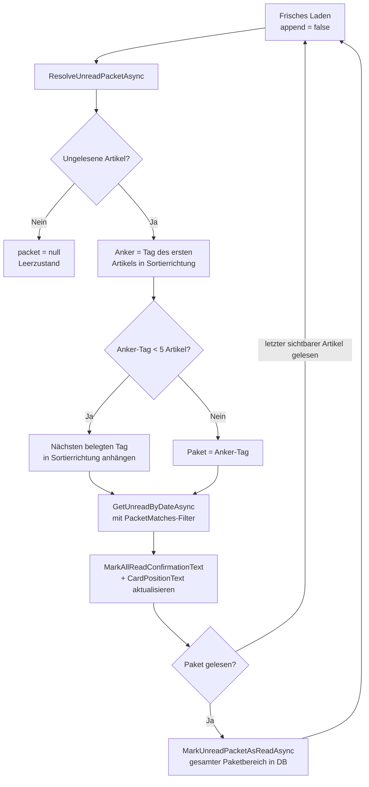

<!-- Licensed under the PolyForm Noncommercial License 1.0.0 - see the LICENSE file in the project root for details. -->

← [Zurück zur Übersicht](index.md)

# Ungelesen — Technischer Ablauf

## Übersicht

Die Startseite **Ungelesen** lädt ungelesene Artikel als **Lesepaket**: Nur Artikel eines Kalendertags (Anker-Tag) — bei weniger als `MinPacketSize` (5) Artikeln zusätzlich des nächsten belegten Tags in Sortierrichtung — kommen in die Liste. Die Paket-Ermittlung liegt vollständig in `ItemRepository` (`ResolveUnreadPacketAsync`), das Ergebnis-Record `UnreadPacket` steuert über ein gemeinsames Prädikat (`PacketMatches`) Lese-, Zähl- und Markierpfad konsistent. Das `UnreadViewModel` triggert die Paket-Ermittlung ausschließlich beim frischen Laden (`LoadPageAsync` mit `append == false`).

## Ablauf

### 1. Frisches Laden und Paket-Ermittlung

Auslöser: `OnAppearing` → `LoadCommand`, `RefreshAsync` (Pull-to-Refresh), `SelectCategoryAsync` (Filter-Tab), `MarkAllReadAsync` (nach „Paket gelesen") und `MarkReadAsync` bei leer gewordener Liste — alle enden in `UnreadViewModel.LoadPageAsync(page: 0, append: false)`.

1. `LoadPageAsync` liest `ISettingsRepository.GetAsync()` und leitet `ascending` aus `Settings.UnreadSortOrder` ab.
2. Bei `append == false` ruft es `IItemRepository.ResolveUnreadPacketAsync(categoryId, ascending)` auf und hält das Ergebnis in `_currentPacket` (`null` = keine ungelesenen Artikel → leere Seite/Leerzustand).
3. `ItemRepository.ResolveUnreadPacketAsync`:
   - Basisabfrage `Items.Where(i => !i.IsRead)` plus optionalem `categoryId`-Filter über die `feedIds`-Subquery; leer → `null`.
   - Der Anker ist das `PublishedAt` des ersten Elements in der **aktiven** Sortierreihenfolge (dieselbe Ordnung wie die Listenabfrage: aufsteigend `OrderBy(PublishedAt).ThenByDescending(Id)`, absteigend `OrderByDescending(PublishedAt).ThenBy(Id)`).
   - `PublishedAt == null` → `ResolveUndatedAnchorPacketAsync` (Pseudo-Tag: aufsteigend das erste, absteigend das letzte Paket — spiegelt das SQLite-`NULL`-Sortierverhalten); sonst `ResolveDatedAnchorPacketAsync` mit dem lokalen Kalendertag (`LocalDayOf` — `PublishedAt` ist UTC, `DateTime.SpecifyKind` + `ToLocalTime().Date`).
   - Zählt der Anker-Tag `< MinPacketSize` Artikel, wird der nächste **belegte** Tag in Sortierrichtung als Folgetag angebunden (aufsteigend `PublishedAt >= toUtc`, absteigend `PublishedAt < fromUtc`, absteigend ohne Treffer zusätzlich der undatierte Pseudo-Tag via `IncludeUndated`); Tage ohne ungelesene Artikel dazwischen werden übersprungen, weil das Paket als halboffenes UTC-Fenster `[FromUtc, ToUtc)` modelliert ist.
   - `Days` hält die konkreten lokalen Kalendertage (`DateOnly?`; `null`-Eintrag = Pseudo-Tag) für das Dialog-Label — aus dem UTC-Fenster nicht rekonstruierbar, wenn Leertage übersprungen wurden.
4. `GetUnreadByDateAsync(page, PageSize, categoryId, ascending, packet)` filtert über `PacketMatches(packet)` — `packet == null` bedeutet unbegrenzt (Altverhalten für andere Aufrufer); die Seite wird wie bisher über `SelectListItemRows`/`MapToListItem` projiziert.
5. Nur beim frischen Laden setzt das ViewModel die Paket-Anzeigestate: `_packetUnreadCount` via `GetUnreadPacketCountAsync(packet, categoryId)` (Gesamt-Paket-Anzahl inkl. noch nicht geladener Artikel) und `_packetDayLabel` via `string.Join(" + ", packet.Days …)` (Kurzdatum `d` der aktuellen Kultur, `null`-Eintrag → `AppResources.UnreadNoDateLabel`); danach `OnPropertyChanged` für `MarkAllReadConfirmationText` und `CardPositionText`.

Beteiligte Komponenten:

- `UnreadViewModel.LoadPageAsync` — Orchestrierung, Paket-State (`_currentPacket`, `_packetUnreadCount`, `_packetDayLabel`)
- `ItemRepository.ResolveUnreadPacketAsync` / `ResolveDatedAnchorPacketAsync` / `ResolveUndatedAnchorPacketAsync` — Anker- und Folgetag-Logik
- `ItemRepository.LocalDayOf` / `DayBoundsUtc` — lokaler Kalendertag ↔ UTC-Grenzen
- `UnreadPacket` (`Reporter.Core.Models`) — Parameter-Record: `FromUtc`/`ToUtc`, `IncludeUndated`, `Days`
- `ItemRepository.PacketMatches` — geteiltes `Expression<Func<ItemEntity, bool>>`-Prädikat (halboffenes Fenster `OR` undatiert; halboffene Grenzen ohne Gegenstück werden mit `ArgumentException` abgelehnt)
- `ItemRepository.MinPacketSize` — fachlicher Festwert `5` (public für Tests)

### 2. Nachladen innerhalb des Pakets (`LoadMoreAsync`)

`LoadMoreAsync` erhöht `_currentPage` und ruft `LoadPageAsync(page, append: true)` — das mitgeführte `_currentPacket` wird wiederverwendet, keine neue Paket-Ermittlung. Eine Seite mit `< PageSize` Treffern setzt `HasMore = false`; die Liste endet am Paketende, der Folgetag wird nicht per Scrollen nachgeladen.

### 3. „Paket gelesen" (`MarkAllReadCommand`)

1. `UnreadPage.OnMarkAllReadTapped` (Guard `HasArticles`) zeigt `DisplayActionSheetAsync` mit Titel `MarkAllReadConfirmationText` — `string.Format` über `MarkAllReadPacketTitleSingularFormat` (`_packetUnreadCount == 1`) bzw. `MarkAllReadPacketTitleFormat` mit `_packetUnreadCount` und `_packetDayLabel` — sowie `ButtonCancel` und `ButtonMarkPacketRead`. Der Button trägt die `SemanticProperties.Description` `UnreadMarkPacketReadHint`.
2. Bei Bestätigung ruft `MarkAllReadAsync` bei `_currentPacket != null` `ItemRepository.MarkUnreadPacketAsReadAsync(packet, categoryId)` auf — `ExecuteUpdate` setzt `IsRead`/`ReadAt` für den **gesamten Paketbereich** in der Datenbank, unabhängig davon, wie viele Paket-Artikel tatsächlich in `Articles` geladen waren. Bei `_currentPacket == null` wird die Markierung übersprungen und direkt geladen (defensiver Pfad, über die UI praktisch nicht erreichbar).
3. `LoadAsync` lädt frisch → `ResolveUnreadPacketAsync` findet den nächsten Anker → die Liste zeigt das Folgepaket. Abbruch: keine Markierung, kein Reload.

### 4. Einzelnes Als-gelesen-Markieren (`MarkReadCommand`)

1. `MarkReadAsync` markiert per `MarkAsReadAsync` und entfernt den Eintrag aus `Articles` — `_currentPacket` bleibt unangetastet, kein Nachrücken des Folgetags.
2. `_packetUnreadCount = Math.Max(0, _packetUnreadCount - 1)` (gleiches Pflegemuster wie `UnreadCount`); `OnPropertyChanged` auf `MarkAllReadConfirmationText` und `CardPositionText`, damit Dialogtitel und Karten-Nenner (`Math.Max(_packetUnreadCount, _articles.Count)`) nicht veralten.
3. Bei `Articles.Count == 0` → `LoadAsync` → frisches Neuladen mit neuer Paket-Entscheidung (nächstes Paket).

## Diagramm

## Fehlerbehandlung

- `LoadPageAsync` fängt alle Exceptions (`Debug.WriteLine` + `ErrorMessage = AppResources.ErrorLoadFailed`); `MarkAllReadAsync` setzt `ErrorMessage = AppResources.ErrorActionFailed` und lädt nicht neu.
- `PacketMatches` wirft `ArgumentException` bei genau einer gesetzten Bereichsgrenze — ein halboffenes Paket würde sonst zu einem falschen Prädikat auf dem destruktiven Markierpfad degradieren.
- Parallel angestoßene Ladevorgänge werden serialisiert: `LoadPageAsync` setzt bei `IsLoading` nur `_reloadPending` und führt den Auftrag nach Abschluss als `LoadAsync` nach — ein vermischter Paket-/Kategoriezustand kann so nicht entstehen.
